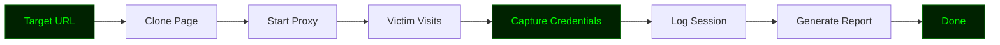

# TPHISHER

<!-- ═══════════════════════════════════════════════════════════════════════ -->
<!--                        TPHISHER - README.md                             -->
<!--              Professional Phishing Simulation Documentation             -->
<!-- ═══════════════════════════════════════════════════════════════════════ -->

<div align="center">

# 🎣 TPHISHER

### `Simulate • Train • Protect`

**A Python-based phishing simulation toolkit for security awareness training.**

[](https://github.com/anonmoty/TPHISHER)
[](https://python.org)
[](LICENSE)
[](https://github.com/anonmoty/TPHISHER)
[](https://github.com/anonmoty/TPHISHER)

</div>

---

```
████████████████████████████████████████████████████████████████████████
█                                                                      █
█   ████████╗██████╗ ██╗  ██╗██╗███████╗██╗  ██╗███████╗██████╗        █
█   ╚══██╔══╝██╔══██╗██║  ██║██║██╔════╝██║  ██║██╔════╝██╔══██╗       █
█      ██║   ██████╔╝███████║██║███████╗███████║█████╗  ██████╔╝       █
█      ██║   ██╔═══╝ ██╔══██║██║╚════██║██╔══██║██╔══╝  ██╔══██╗       █
█      ██║   ██║     ██║  ██║██║███████║██║  ██║███████╗██║  ██║       █
█      ╚═╝   ╚═╝     ╚═╝  ╚═╝╚═╝╚══════╝╚═╝  ╚═╝╚══════╝╚═╝  ╚═╝       █
█                                                                      █
█                    [ Simulate | Train | Protect ]                    █
█                                                                      █
████████████████████████████████████████████████████████████████████████
```

---

## ⚠️ Disclaimer

```
╔══════════════════════════════════════════════════════════════════════╗
║                                                                      ║
║   TPHISHER is built for EDUCATIONAL and AUTHORIZED training only.    ║
║                                                                      ║
║   ▸ Use ONLY on systems you own or have written permission for.      ║
║   ▸ Unauthorized phishing is ILLEGAL.                                ║
║   ▸ Follow ethical guidelines and local laws at all times.           ║
║   ▸ The author is NOT responsible for any misuse.                    ║
║                                                                      ║
║   Train responsibly. Learn ethically. Protect proactively.           ║
║                                                                      ║
╚══════════════════════════════════════════════════════════════════════╝
```

---

## 🎯 What Is TPHISHER?

**TPHISHER** is a Python-based **phishing simulation toolkit** designed for **security awareness training and red team engagements**. It helps organizations test their employees' awareness of phishing attacks in a controlled, ethical environment.

Built for:
- 🎓 Security awareness trainers
- 🔬 Red team operators
- 🛡️ SOC analysts
- 🧪 Penetration testers

---

## ✨ Features

```
┌─────────────────────────────────────────────────────────────────────┐
│  [01] 🎣 Phishing Page Clone   → Clones target login pages           │
│  [02] 🔗 Proxy Handler         → Proxies requests safely             │
│  [03] 📋 Credential Logger     → Logs submitted credentials          │
│  [04] 🌐 Custom Templates      → Bring your own templates            │
│  [05] 📧 Email Template Gen    → Generates realistic emails          │
│  [06] 📊 Campaign Manager      → Tracks multiple campaigns           │
│  [07] 🔍 Live Monitor          → Real-time session tracking          │
│  [08] ⚡ Multi-Threaded        → Fast parallel processing            │
│  [09] 📝 JSON Reports          → Structured, machine-readable output │
│  [10] 🎨 Hacker Terminal UI    → Dark green aesthetic                │
└─────────────────────────────────────────────────────────────────────┘
```

---

## 🚀 Installation

```bash
# Clone the repo
git clone https://github.com/anonmoty/TPHISHER.git
cd TPHISHER

# Install dependencies
pip install -r requirements.txt

# Run
python start.py --help
```

**One-liner:**

```bash
git clone https://github.com/anonmoty/TPHISHER.git && cd TPHISHER && pip install -r requirements.txt && python start.py --help
```

---

## 🎯 Usage

```bash
# Start the proxy
python start.py --port 8080

# Clone a target page
python start.py --clone https://example.com/login

# Full training mode
python start.py --clone https://example.com/login --port 8080 \
                --output logs/sessions.json --verbose
```

### CLI Flags

```
┌─────────────────────────────────────────────────────────────────────┐
│  --clone        →  URL of page to clone                             │
│  --port         →  Local port (default: 8080)                       │
│  --output       →  Log output path                                  │
│  --template     →  Custom template directory                        │
│  --verbose      →  Verbose logging                                  │
│  --help         →  Show help                                        │
└─────────────────────────────────────────────────────────────────────┘
```

---

## 🧠 How It Works



1. **Clone** — Copies the target login page
2. **Proxy** — Serves the cloned page locally
3. **Capture** — Logs submitted credentials
4. **Report** — Outputs structured session data

---

## 📁 Structure

```
TPHISHER/
├── start.py
├── core/
│   ├── cloner.py
│   ├── proxy.py
│   ├── logger.py
│   └── reporter.py
├── templates/
│   ├── login.html
│   └── style.css
├── logs/
├── tests/
├── requirements.txt
├── LICENSE
└── README.md
```

---

## 📸 Demo

```
██████████████████████████████████████████████████████████████████████
█                                                                    █
█   TPHISHER v1.0.0                                                  █
█   ───────────────────────────────────────────────────────────      █
█                                                                    █
█   [✓] Cloning: https://example.com/login                           █
█   [✓] Proxy running on: http://localhost:8080                      █
█   [→] Waiting for victim...                                        █
█                                                                    █
█   [████████████████████████░░░░░░] 80%                             █
█                                                                    █
█   [!] SESSION: 192.168.1.50  →  Credentials captured               █
█   [✓] Log saved: logs/sessions_2024.json                           █
█                                                                    █
█                     Train Smart! 🎣                                █
█                                                                    █
██████████████████████████████████████████████████████████████████████
```

---

## 🛠️ Requirements

```txt
Flask>=2.3.0
requests>=2.28.0
aiohttp>=3.9.0
colorama>=0.4.6
beautifulsoup4>=4.11.0
tqdm>=4.65.0
rich>=13.0.0
```

```bash
pip install -r requirements.txt
```

---

## 🎨 Terminal Theme

TPHISHER uses a **dark green** hacker palette:

```python
THEME = {
    "primary":   "\033[38;5;28m",   # Dark Green
    "secondary": "\033[38;5;34m",   # Forest Green
    "accent":    "\033[38;5;46m",   # Bright Green
    "error":     "\033[38;5;196m",  # Red
    "warning":   "\033[38;5;220m",  # Yellow
    "info":      "\033[38;5;46m",   # Green
    "reset":     "\033[0m",
}
```

---

## 🔥 Power Tips

```bash
# TPHISHER + ngrok
python start.py --clone https://example.com/login --port 8080
ngrok http 8080

# TPHISHER + custom template
python start.py --clone https://example.com/login --template ./my_template/
```

---

## 🐛 Training Workflow

```
██████████████████████████████████████████████████████████████████████
█                                                                    █
█   [01] Campaign Setup       →  Define target & scope               █
█   [02] Page Cloning         →  TPHISHER  ← you are here            █
█   [03] Email Delivery       →  Send simulated phish                █
█   [04] Session Capture      →  Log credentials                     █
█   [05] Awareness Report     →  Analyze results                     █
█                                                                    █
██████████████████████████████████████████████████████████████████████
```

### Use Cases

- 🎓 Employee awareness training
- 🔬 Red team phishing simulations
- 🛡️ SOC detection testing
- 📊 Security posture assessment

---

## 🗺️ Roadmap

```
┌─────────────────────────────────────────────────────────────────────┐
│  [x] Page cloning                                                   │
│  [x] Proxy handler                                                  │
│  [x] Credential logging                                             │
│  [x] JSON reports                                                   │
│  [x] Hacker terminal UI                                             │
│  [ ] Email template generator                                       │
│  [ ] Campaign manager                                               │
│  [ ] Analytics dashboard                                            │
│  [ ] Docker image                                                   │
│  [ ] Multi-user support                                             │
└─────────────────────────────────────────────────────────────────────┘
```

---

## 🤝 Contributing

1. Fork the repo
2. Create branch (`git checkout -b feature/amazing`)
3. Commit (`git commit -m 'Add amazing feature'`)
4. Push (`git push origin feature/amazing`)
5. Open Pull Request

---

## 📜 License

MIT License. See [`LICENSE`](LICENSE).

---

## 🙏 Credits

- **Author:** [@anonmoty](https://github.com/anonmoty)
- **Inspired by:** The security awareness community
- **Built with:** Python, caffeine, and curiosity ☕

---

<div align="center">

```
██████████████████████████████████████████████████████████████████████
█                                                                    █
█        🎣  TRAIN SMART.  PHISH ETHICALLY.  PROTECT ALWAYS.  🎣     █
█                                                                    █
█                  ⭐  If this tool helped you, star it!  ⭐           █
█                                                                    █
██████████████████████████████████████████████████████████████████████
```

</div>


